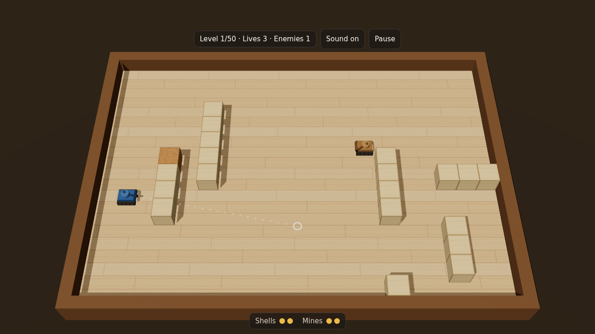

# Tanks

A three-quarter view tank game for the browser and your phone. Drive with WASD, aim with the mouse, bank shots off the walls, and pop every enemy tank across 50 levels, or take on another player online.

**Play it:** https://tanks.nathanhealea.com



Hit a tank and it bursts like a balloon: it swells, snaps into rubbery shreds of its own color, and leaves a scuffed X on the floor. The game installs as an app (a progressive web app, or PWA) and plays offline once loaded.

## How to play

Clear the board to finish a level. You carry two shells and two mines. When you've used both, they reload: shells take 2 seconds, mines take 8. Shells bounce off walls once, and your own rebound can pop you.

| Action | Keyboard and mouse | Touch |
| --- | --- | --- |
| Drive | <kbd>W</kbd> <kbd>A</kbd> <kbd>S</kbd> <kbd>D</kbd> | Drag on the left half of the screen |
| Aim | Mouse, or <kbd>←</kbd> <kbd>→</kbd> | Touch the right half |
| Fire | Left click or <kbd>Space</kbd> | Lift your finger from the right half |
| Drop a mine | Right click or <kbd>F</kbd> | **Mine** button |
| Pause | <kbd>Esc</kbd> or <kbd>P</kbd> | **Pause** button |

Mines go off when an enemy drives near one or after 9 seconds. The blast pops every tank in range, yours included, and breaks cork blocks. The plain wood blocks don't break.

On a phone, play in landscape.

## Play online

Choose **Play online** on the title screen. There's no account: each time you open the page you get a new random ID, and your browser doesn't save it.

- **Quick match** pairs you with the next player who searches.
- **Create private match** gives you a six-character code, like `HK7-Q2M`, and a link to send a friend. The code works for 10 minutes; **Keep this code** gives it another 10.
- **Join with code** takes a friend's code. Opening their link fills it in for you; you still press **Join**.

A match is first to three rounds, on a new random arena each round. Your tank is the one with a dark ring around it. When the match ends, both players can ask for a rematch.

**Esc** opens **Leave match?**. Leaving counts as a loss, and so does keeping the tab hidden for 15 seconds. If the connection drops, a countdown shows how long the game waits; after 15 seconds of silence it settles the match. If your opponent has gone, you win. If you're both still here and only the link failed, there's no result.

Online play is capped so it stays inside the relay's free allowance: 20 matches can start per hour. If the hour is full, you'll see that you're in line, and your match starts when a spot opens. If a lot of players start games in the same minute, you may be asked to try again in a minute.

### What online play shares

Your IP address is your internet address. It can show roughly where you are.

- **With other players:** nothing that identifies you. Every match goes through Cloudflare's relay, so your opponent never sees your IP address, only the relay's. They see your tank and your moves.
- **With Cloudflare:** your IP address, because it serves the site and relays the match traffic. The relay can see that two addresses played each other, when, and how much data they sent, but not the game data, which is encrypted between the two browsers.
- **With Convex** (the game's server): your IP address, because your browser connects to it; your random ID; and for each match, whether you were host or guest, the score, how it ended, the private code if there was one, and when you were last connected. Every match record is deleted 24 hours after the match starts. While you wait for a quick match, Convex holds your ID until you're paired or leave. The connection setup messages are deleted as soon as the match connects, and within two minutes otherwise.

The campaign stays offline and shares nothing.

## The enemies

A new tank type joins the mix every 10 levels. Each level after that draws its enemies from every type unlocked so far.

| From level | Tank | Color | Speed | Shells | Shell bounces | Mines | What to expect |
| --- | --- | --- | --- | --- | --- | --- | --- |
| 1 | Turret | Tan | Doesn't move | 2 | 1 | 0 | Stays put and takes its time |
| 11 | Roamer | Olive | 2.0 | 2 | 1 | 0 | Drives around looking for an angle |
| 21 | Hunter | Brick red | 2.6 | 2 | 1 | 2 | Fast, closes in, drops mines |
| 31 | Rocket | Teal | 1.6 | 1 | 0 | 0 | Slow, but its shell is nearly twice as fast as yours |
| 41 | Ace | Purple | 2.8 | 3 | 2 | 2 | Quick, and its shells bounce twice |

Your tank moves at 2.4. Speeds are in floor tiles per second.

### Difficulty curve

Enemy skill follows `1 − (10 − level/5)² / 100`. It starts near zero and climbs quickly through the early levels, then flattens toward 1.0 at level 50:

| Level | 1 | 10 | 20 | 30 | 40 | 50 |
| --- | --- | --- | --- | --- | --- | --- |
| Skill | 0.04 | 0.36 | 0.64 | 0.84 | 0.96 | 1.00 |

Skill sets how fast enemies aim, how often they fire and how fast they move. Past 0.5 (level 15), they also bank shots off the walls, dodge your shells and drop mines, if their type carries them.

Enemy count grows from 1 on the first levels to 8 by level 49.

## Run it locally

You need Node 22.12 or newer.

```sh
npm install
npm run dev
```

Open the URL Vite prints. Without a Convex backend the campaign works and **Play online** stays hidden. `npm run dev` also serves on your local network, so a phone on the same Wi-Fi can connect. One catch: under WSL2 your phone usually can't reach the dev server. Deploy instead (see below), or turn on WSL's mirrored networking.

| Command | What it does |
| --- | --- |
| `npm run dev` | Dev server with hot reload |
| `npm run build` | Type-check, then build to `dist/` |
| `npm run preview` | Serve the production build; the service worker only runs here |
| `npm run typecheck` | Type-check the game and the Convex functions |
| `npm test` | Run the tests once |
| `npm run deploy` | Deploy the Convex backend, then build and publish the site (see below) |

### With online play

Online play needs a [Convex](https://www.convex.dev) project and a Cloudflare TURN key.

1. Run `npx convex dev` and follow the prompts to sign in and create a project. It writes `CONVEX_DEPLOYMENT` and `VITE_CONVEX_URL` to `.env.local` (git-ignored) and keeps your functions in sync while it runs. `.env.example` lists every variable.
2. In the Cloudflare dashboard, open **Realtime → TURN** and create a TURN key. Set its ID and API token on your dev deployment from your own terminal:
   ```sh
   npx convex env set CLOUDFLARE_TURN_KEY_ID <key id>
   npx convex env set CLOUDFLARE_TURN_KEY_API_TOKEN <api token>
   ```
   These stay in Convex. Never put them in a `VITE_` variable: those are compiled into the public site.
3. In a second terminal, run `npm run dev`. Open two browser windows to play yourself.

Without the TURN key, matches can't connect and the game says online matches can't start right now. That's deliberate: there's no fallback to a direct connection, so players never see each other's IP address.

## Deploy

The game has two halves. Convex runs the online backend. The site is a static-assets Cloudflare Worker, defined in `wrangler.json` and served at `tanks.nathanhealea.com`.

One-time setup:

1. **Cloudflare:** create an API token that can deploy Workers and manage the `nathanhealea.com` zone. The zone access is what lets the deploy attach the custom domain.
2. **Convex:** in the Convex dashboard, switch to the project's production deployment and generate a deploy key in its settings. A production key starts with `prod:`.
3. **Put both in `.env`** at the project root. `.env` is git-ignored. Use `.env`, not `.env.local`: `.env.local` holds your dev key, and the deploy refuses anything that isn't a production key.
   ```sh
   CLOUDFLARE_API_TOKEN=your-cloudflare-token
   CONVEX_PROD_DEPLOY_KEY=prod:your-key
   ```
4. **Production TURN key:** create a separate TURN key for production (don't reuse the dev one). In the Convex dashboard, switch to the production deployment and add `CLOUDFLARE_TURN_KEY_ID` and `CLOUDFLARE_TURN_KEY_API_TOKEN` in its environment variable settings. Don't use `npx convex env set --prod` for this: with your dev key in `.env.local`, the CLI ignores `--prod` and writes to the dev deployment.
5. **Billing notification:** in Cloudflare, set one for Realtime. The 20-matches-an-hour cap is sized to stay inside the free 1,000 GB a month, but it's an estimate, and only a billing notification catches a leaked relay login.

Then run `npm run deploy`. It deploys the Convex functions to production, builds the site pointed at that backend, and publishes the site. If any step fails, the site isn't published.

The backend goes live before the site. A change to how matches are recorded can strand players mid-match on the old site, so keep backend changes compatible with the previous site for one release.

Every file is served with `Cache-Control: max-age=0, must-revalidate`, so a new deploy shows up on the next page load. An installed copy on a phone may need to be closed and reopened once.

## How the code is laid out

```
src/
  game/      simulation: plain TypeScript, no React, no three.js
    sim.ts       step(state, inputs) advances the world one 60 Hz tick
    ai.ts        enemy aiming, bank-shot tracing, grid pathfinding
    levels.ts    50 seeded level layouts and the difficulty curve
    tanks.ts     per-type stats and the order types unlock
    config.ts    shared tuning: reload times, bullet size, mine fuse
    session.ts   fixed-timestep clock around step()
  render/    three.js scene through @react-three/fiber: tanks, arena, particles, camera
  input/     keyboard and mouse, turned into a PlayerInput each frame
  ui/        HUD and touch controls
    online/      online menus, match screens, and the flow that ties them together
  net/       online play in the browser
    peer.ts        WebRTC connection; setup messages travel through Convex
    iceServers.ts  STUN and TURN servers; TURN logins come from Convex
    hostSession.ts the host runs step() for both players and sends snapshots
    guestSession.ts the guest sends input and draws what the host sends
    silence.ts     pings, lost-connection countdown, and goodbye messages
  audio/     synthesized sound effects (Web Audio, no audio files)
convex/      the online backend
  matchmaking.ts quick-match queue and pairing
  privateMatch.ts private codes
  signaling.ts   WebRTC setup messages, deleted once a match connects
  matches.ts     scores, rematches, leaving, presence, lost connections
  turn.ts        short-lived TURN logins from Cloudflare
  sweep.ts       runs every minute: clears stale queue entries, dead matches, old records
public/      manifest, service worker, icons
scripts/     the deploy script
```

Levels are generated rather than drawn by hand. Each level number has a fixed seed, so every player gets the same 50 maps. The generator throws out any layout where an enemy can see your spawn or can't be reached by driving.

## Tuning

| To change | Edit |
| --- | --- |
| Reload times, mine fuse and blast radius, tank size | `src/game/config.ts` |
| Each enemy type's speed, shells, bounces and mines | `src/game/tanks.ts` |
| How enemies aim, fire, dodge and wander | `PROFILES` and `scaled()` in `src/game/ai.ts` |
| Difficulty curve, enemy count, level layouts | `src/game/levels.ts` |
| Lives | `MAX_LIVES` in `src/game/config.ts` |

## How online play works

The host's browser runs the real simulation, `step()` with both players' inputs, 60 times a second. It sends the guest a snapshot 30 times a second. The guest sends only its own input and draws the snapshots slightly in the past, so movement stays smooth. The two browsers talk over a WebRTC data channel through Cloudflare's relay. Convex never carries game traffic; it pairs players, passes the connection setup messages, and records the score.

## Built with

[React](https://react.dev), [three.js](https://threejs.org) through [@react-three/fiber](https://r3f.docs.pmnd.rs), [Vite](https://vite.dev), TypeScript, [Convex](https://www.convex.dev) for the online backend, [Cloudflare Workers](https://developers.cloudflare.com/workers/static-assets/) for hosting, and [Cloudflare Realtime TURN](https://developers.cloudflare.com/realtime/turn/) for the relay.
